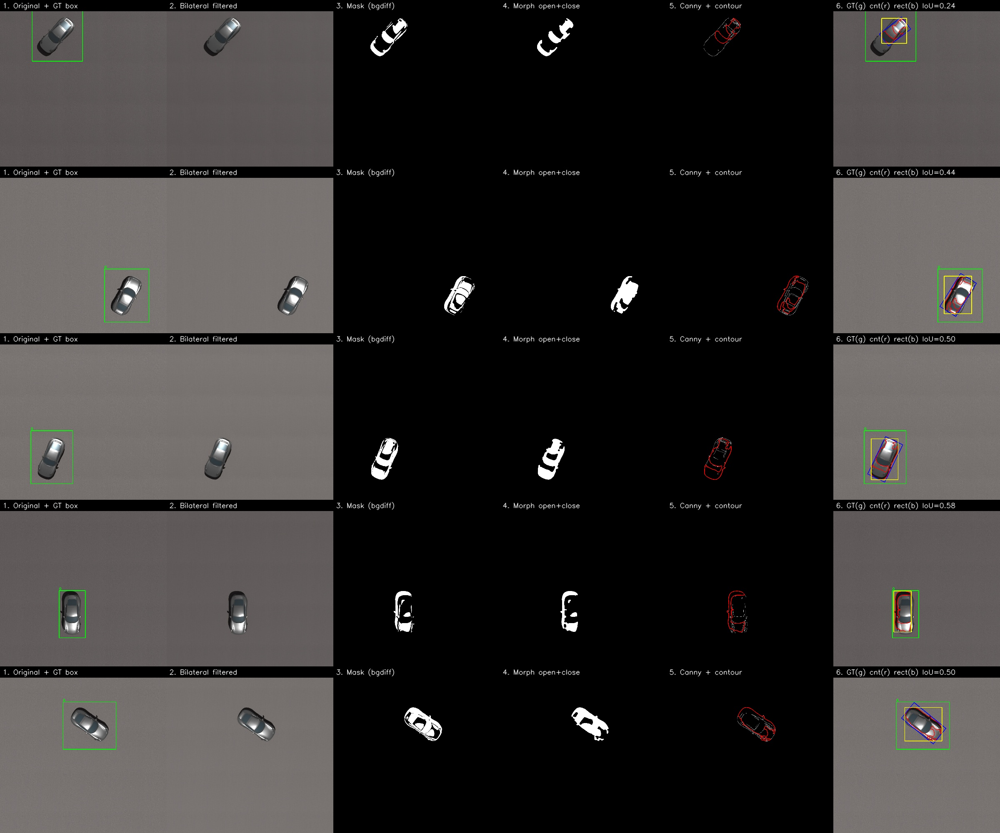
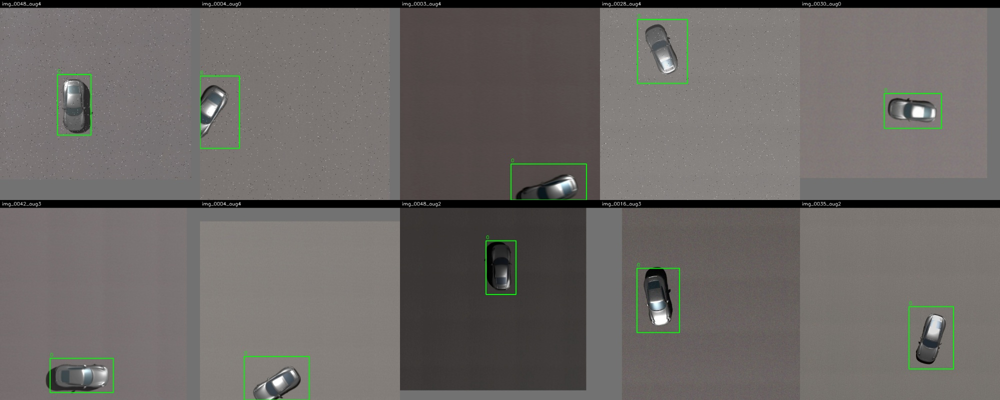

# Task 2 – Image Preprocessing, Classical Processing & YOLO Dataset Augmentation

OpenCV pipeline built on the 50-image synthetic Blender aerial dataset (car, 45 m altitude, PBR ground) and its YOLO ground-truth labels from Task 1.

## Repository contents

| File | Purpose |
|---|---|
| `classical_processing.py` | Part 1: GT box drawing, filtering, thresholding / masking, morphology, Canny, contours, comparison grids, IoU vs GT |
| `find_hsv_range.py` | Helper: samples HSV values inside GT boxes to test whether colour masking can work |
| `augment_dataset.py` | Part 2: letterbox to 640×640, split by base image, photometric + geometric augmentation with label updates, `data.yaml` |
| `verify_bboxes.py` | Draws YOLO boxes on augmented images to verify alignment |
| `utils.py` | YOLO label I/O, coordinate conversion, box drawing, IoU |
| `data.yaml` | YOLO dataset configuration |
| `requirements.txt` | Python dependencies |

## Setup

```bash
pip install -r requirements.txt
```

Expected input layout: `raw/images/*.jpg|png` and `raw/labels/*.txt` (same file stems).

## Part 1 – Annotation verification & classical image processing

```bash
python classical_processing.py --images raw/images --labels raw/labels --out results/part1 --n 5 --method bgdiff --bg-kernel 301
```

Pipeline per image:

1. Parse the YOLO label (`class xc yc w h`, normalized), convert to pixel `(x_min, y_min, x_max, y_max)` and draw it with `cv2.rectangle()` (green).
2. Convert BGR → Grayscale and HSV (`cv2.cvtColor`).
3. Smooth with a bilateral filter followed by a light Gaussian blur to suppress ground texture while keeping edges.
4. Segment the car (see methods below).
5. Clean the mask with morphological opening (remove specks) and closing (fill holes), using an elliptical kernel.
6. Detect edges with `cv2.Canny`, extract contours with `cv2.findContours`, and draw the largest contour (red), its `minAreaRect` (blue) and its axis-aligned bounding box (yellow) next to the GT box.
7. Compute IoU between the classical bounding box and the ground-truth box.

### Part 1 comparison grid

Columns: Original + GT box → Bilateral filtered → Mask → Morphology (open + close) → Canny + largest contour → Overlay (GT green, contour red, min-area rect blue, bounding box yellow, IoU in title).



### Methods compared (5 sample images)

| Method | IoU per image (0043, 0001, 0028, 0014, 0036) | Mean IoU |
|---|---|---|
| Otsu global threshold | 0.094, 0.085, 0.080, 0.045, 0.506 | **0.16** |
| HSV colour range (`cv2.inRange`) | not usable (see below) | – |
| Background difference (median background, kernel 301) + Otsu | 0.242, 0.436, 0.496, 0.577, 0.499 | **0.45** |

Background-difference kernel sweep (same 5 images): auto ≈ 0.35, 101 ≈ 0.34, 201 ≈ 0.42, 301 ≈ 0.45.

### Discussion

- **Global thresholding (Otsu)** performed poorly. The car is a mid-gray object on a mid-gray textured PBR ground, so a single intensity threshold also captures large areas of ground and shadow, and the resulting contour is much larger than the car.
- **HSV masking** was tested with `find_hsv_range.py`. The HSV range covering the car (low saturation, mid value) also matched **100 % of the background pixels**, so colour alone cannot separate the car from the ground.
- **Background difference** estimates the ground with a large median blur (which removes the small car), then thresholds the absolute difference. It improved the mean IoU from 0.16 to 0.45, and larger kernels helped because the background estimate stops absorbing the car. It still struggles on images where the car's shadow or low contrast to the ground breaks the mask.
- **Conclusion:** classical processing is useful for verifying labels and understanding the data, but at 45 m a small gray object on a textured ground has too little colour and intensity contrast for reliable hand-crafted segmentation. This motivates a learned detector (YOLO) trained on the augmented dataset.
- Note: for Otsu, the threshold polarity (bright vs dark object) was chosen by comparing mean intensity inside and outside the GT box. The background-difference method does not use the GT box except to compute IoU.

## Part 2 – Dataset preprocessing & bounding-box-aware augmentation

```bash
python augment_dataset.py --images raw/images --labels raw/labels --out dataset --names car --variants 5
python verify_bboxes.py --dataset dataset --split train --n 10 --out results/part2/verification_grid.jpg
```

**Preprocessing:** every image is letterboxed to 640×640 (aspect ratio preserved, gray padding) with `cv2.resize`, and the YOLO labels are remapped to the padded canvas.

**Split (no data leakage):** the 50 base images are shuffled (seed 42) and split **before** augmentation into 70 % / 20 % / 10 % → 35 / 10 / 5 base images. All augmented versions of a base image stay in the same split.

**Augmentation:** each base image produces 1 clean letterboxed copy (`_orig`) + 5 augmented variants (`_aug0` … `_aug4`) → **300 images total** (train 210, val 60, test 30).

- Photometric (labels unchanged), 2–3 random per variant: brightness/contrast, HSV hue/saturation/value shift, Gaussian or salt-and-pepper noise, Gaussian or motion blur.
- Geometric (labels recomputed), one random fixed transform and/or a random affine: horizontal flip (`cv2.flip`), vertical flip, 90° / 180° / 270° rotation (`cv2.rotate`), random scale (0.7–1.3) and translation (`cv2.warpAffine`).
- Label updates: flips and rotations use exact normalized coordinate formulas (e.g. 90° clockwise: `(xc, yc, w, h) → (1 − yc, xc, h, w)`); for the affine transform the four box corners are transformed, clipped to the image, and the box is dropped if less than 40 % of it stays visible.
- Every file's applied operations are logged in `dataset/augmentation_log.csv`.

### Part 2 verification grid (10 augmented images)

Boxes are drawn from the updated label files and stay on the car after flips, rotations, scaling, translation, and edge cropping.



## Dataset

```
dataset/
├── data.yaml
├── train/{images,labels}   # 210 images
├── val/{images,labels}     #  60 images
└── test/{images,labels}    #  30 images
```

`data.yaml`:

```yaml
train: train/images
val: val/images
test: test/images

nc: 1
names:
  0: car
```

**Google Drive link to the dataset:** <PASTE YOUR DRIVE LINK HERE>
